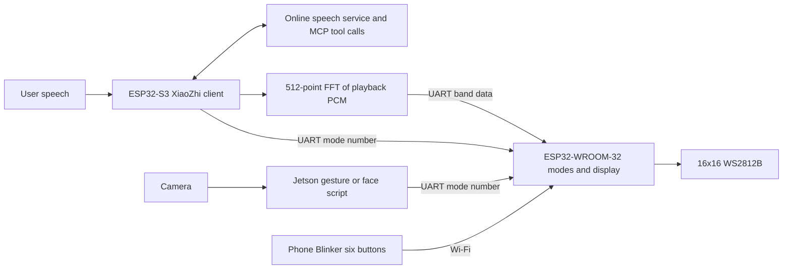

# Intelligent Lighting Control System — Mid

A multimodal lighting prototype combining two ESP32 controllers, Jetson Nano, online speech, and playback-spectrum visualization.

[简体中文](README.md) · **English** · [日本語](README_JA.md)

**Explore:** [Modules and versions](docs/technical-notes.en.md#source-map) · [Audio processing](docs/technical-notes.en.md#audio) · [Display and games](docs/technical-notes.en.md#display-games) · [Vision](docs/technical-notes.en.md#vision) · [Setup](docs/setup.en.md)

Mid, also called “智光魔方”, is the intermediate course prototype in **Basic → Mid → Pro**. An ESP32-S3 uses the open-source XiaoZhi client for online speech services, an ESP32-WROOM-32 runs effects and games, and Jetson Nano recognizes predefined gestures and enrolled faces, sending display-mode commands over UART.

Building on [Basic](https://github.com/DongFengPo1412/Intelligent-Lighting-Control-System-Basic)'s fixed offline commands and random music effects, this stage adds server-side voice tool calls, FFT analysis of actual playback audio, vision controls, and Tetris. [Pro](https://github.com/DongFengPo1412/Intelligent-Lighting-Control-System-Pro) is a separate implementation; this page covers Mid only.

The photograph documents historical four-panel hardware. Current source maps one row-serpentine 16×16 panel. The revised WROOM firmware has been built; S3 has not received a full build, and neither has been reflashed or tested on the panel.

## System architecture

The S3 handles the speech client and playback analysis; WROOM handles pixels, serial dispatch, and game updates. Vision scripts are launched separately, without a unified face/gesture fusion scheduler. Online dialogue and song requests depend on external services; basic serial effects and game logic execute on WROOM.

## Features and implementation

| Feature | Implementation | Scope |
| :--- | :--- | :--- |
| **Voice control** | XiaoZhi handles audio/session transport; `self.device.set_light_mode` converts server tool arguments into serial mode numbers. | Integrates an existing speech framework; no locally trained project LLM. Music search/playback requires server-side tools. |
| **Effects and expressions** | FastLED fill, HSV, sinusoidal, and fading functions combined with custom pixel geometry. | Modes 1–14 include solid colors, rainbow, breathing, meteor, stars, rain, ripples, and faces; not all are animations. |
| **Playback spectrum** | Hann window, 512-point FFT, sixteen band averages, normalization, and logarithmic amplitude compression on playback-queue PCM. | Visualizes speaker-bound audio rather than ambient sound; WROOM applies empirical decay and color overlays. |
| **Two matrix games** | Snake implements wrapping, self-collision, and food-driven speed changes. Tetris implements seven shapes, rotation, collision, and line clearing. | Modes 19/21 enter the games; 20/22 display a two-digit score using 5×3 glyphs. |
| **Phone control** | `BLINKER_WIFI` binds W/S/A/D/E/F buttons. | Direction/rotation/down and two game launchers; no phone color picker or general effect-selector callback. |
| **Gesture and face events** | Rules on MediaPipe Hands landmarks; Haar detection followed by OpenCV LBPH matching against enrolled images. | Open hand/victory/fist map to 5/6/7; enrolled names `ylk`/`zzc` map to 1/2, red/blue. |

[Modes, algorithms, source references, and limitations](docs/technical-notes.en.md)

## Engineering design

- **Task allocation across nodes:** speech/playback analysis, vision, and display execution use separate processors connected by a text serial protocol, allowing input paths to be debugged independently.
- **Shared coordinate mapping:** drawing and spectrum output use `MatrixLayout::PixelIndex`, currently computing alternating row directions on one 16×16 panel.
- **Audio-to-display path:** the S3 sends `f,beat,b0,...,b15`. WROOM parses and refreshes spectra immediately; ordinary modes submit display updates from the loop at intervals greater than 30 ms.
- **Mode conflict handling:** complete valid UART mode commands from S3, Jetson or USB can switch immediately, including leaving music; the old 1.2 s UART guard is gone. Blinker E/F game launchers still reject mode 15, so arbitration remains input-specific.

Equations, band boundaries, game details, and protocol issues are in the [technical notes](docs/technical-notes.en.md). Deployment and feature checks are in the [operation guide](docs/setup.en.md).

## Course demonstration and current status

| Matrix display frame | Phone game-control frames |
| :---: | :---: |
|  |  |

[Watch the course demonstration](https://www.bilibili.com/video/BV192GR6kEHy). These images and video illustrate the course prototype; they do not establish FFT latency, recognition accuracy, or performance of the current single-panel revision. Vision frames are included in the [technical notes](docs/technical-notes.en.md#vision).

Fourteen offline protocol/game cases and the complete WROOM build pass. S3 receives source inspection only. No hardware, training or end-to-end test occurred; historical demonstrations do not validate the maintenance revision.

## Quick start

1. Identify whether the hardware matches the current single-panel serpentine mapping or historical tiled layout; verify power and UART wiring.
2. WROOM needs Arduino ESP32, FastLED, and Blinker. Keep `Config.h` and create the ignored `Config.private.h` for credentials. **Do not overwrite the main configuration with the outdated `Config.example.h`.**
3. The S3 uses ESP-IDF; the current dependency manifest requires **>=5.5.2**. Select the actual board, audio pins, and assets before building; `set-target` alone does not configure the hardware.
4. Jetson needs compatible OpenCV contrib, MediaPipe, NumPy, pyserial, a camera, and a display environment. Check serial communication before launching either the gesture or face program.

Commands, configuration snippets, keys, and prerequisites are in [setup and operation](docs/setup.en.md).

## Team, further work, and license

This is a team course project maintained by **Chaoran Liu / 刘超然**. Course slides list Liu, Zichen Zhang / 张子琛, and Like Yang / 杨立科, but do not establish individual authorship of each module. The software is not attributed entirely to one person.

Next complete the S3 build, confirm physical Flash/partitioning, panel layout and UART wiring, and validate the different phone/UART switching policies. Silence frames, protocol validation and covered game boundaries are repaired; offline checks still do not replace hardware acceptance.

[Technical notes](docs/technical-notes.en.md) · [Setup](docs/setup.en.md) · [Basic](https://github.com/DongFengPo1412/Intelligent-Lighting-Control-System-Basic) · [Pro](https://github.com/DongFengPo1412/Intelligent-Lighting-Control-System-Pro)

The repository uses the [MIT License](LICENSE). The S3 tree retains XiaoZhi client code and upstream documentation. ESP-DSP, ESP-SR, FastLED, Blinker, OpenCV, MediaPipe, and other dependencies retain their own licenses. Project work covers application integration, control protocols, spectrum rendering, games, and vision-triggered interaction; library algorithms are not presented as original project algorithms.

## Maintenance and validation

The 2026-10 revision sends beat plus sixteen bands in silence frames and validates spectrum field count/ranges before updating. After 500 ms without a valid frame, decay continues every 30 ms; zero input no longer forces a lit bottom row. Serial reception uses a fixed 96-byte buffer, drops oversized frames through the delimiter, permits modes 0–16 and 19–22, and requires CR/LF from every sender. Explicit valid mode commands, including 0, can exit music immediately instead of being discarded by the old guard.

Connect S3 GPIO17 TX to WROOM GPIO16 RX with signal ground. Reverse UART is unused: WROOM TX is -1 and S3 does not assign GPIO18 to RX. GPIO18 remains available to the lamp controller; remove the old WROOM-to-S3 reverse wire. Confirm the actual board wiring before operation.

Fourteen offline cases compile the real protocol header/game functions to WebAssembly and pass: modes, silence, malformed/range/overflow frames and game boundaries. S3 was not fully built and no flashing, UART connection or fresh demonstration test occurred; the maintenance report records the WROOM build outcome separately.

The WROOM build passes with Arduino ESP32 3.3.8, FastLED 3.9.15, Blinker 0.3.10230510 and ArduinoJson 7.4.3: application 1348101 bytes, static RAM 60588 bytes. It uses a 4 MiB Flash configuration and the official `min_spiffs` partition (1966080-byte application limit), without verifying physical Flash capacity. The default app partition is too small; confirm hardware and partitioning before upload. FastLED 3.10.5 triggered a compiler internal error here; 3.9.15 passed in isolation without changing global libraries.
