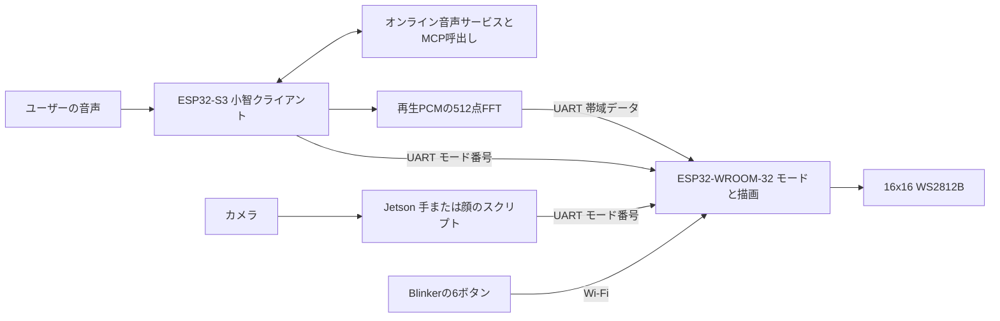

# Intelligent Lighting Control System — Mid

2台のESP32、Jetson Nano、オンライン音声対話、再生音の周波数解析を組み合わせた照明操作の試作機です。

[简体中文](README_ZH.md) · [English](README.md) · **日本語**

**詳細：** [モジュールと版](docs/technical-notes.ja.md#source-map) · [音声処理](docs/technical-notes.ja.md#audio) · [描画とゲーム](docs/technical-notes.ja.md#display-games) · [視覚操作](docs/technical-notes.ja.md#vision) · [導入と操作](docs/setup.ja.md)

Mid（「智光魔方」）は、**Basic → Mid → Pro**の中級授業用プロトタイプです。ESP32-S3がオープンソースの小智クライアントでオンライン音声サービスに接続し、ESP32-WROOM-32が照明とゲームを実行します。Jetson Nanoは登録済みの顔や定義済みジェスチャをカメラで認識し、UARTで表示モードを指令します。

[Basic](https://github.com/DongFengPo1412/Intelligent-Lighting-Control-System-Basic)の定型オフライン命令とランダム照明から発展し、サーバー側の音声ツール呼出し、実際の再生音のFFT解析、視覚操作、テトリスを追加しました。[Pro](https://github.com/DongFengPo1412/Intelligent-Lighting-Control-System-Pro)は別の実装であり、本ページはMidのみを扱います。

写真は授業時の4枚構成の記録で、現ソースは単板16×16の行蛇行写像です。修正WROOMはビルド済み、S3全体は未ビルドで、両方とも書込・パネル再実測はしていません。

## システム構成

S3は音声クライアントと再生音解析、WROOMはピクセル描画、シリアル分配、ゲーム更新を担当します。視覚処理は個別に起動するスクリプトで、顔と手を統合するスケジューラはありません。オンライン対話と楽曲要求には外部サービスが必要で、基本的なシリアル照明とゲーム処理はWROOM上で実行します。

## 機能と実装

| 機能 | 実装方法 | 対応範囲 |
| :--- | :--- | :--- |
| **音声操作** | 小智が音声と会話通信を処理し、`self.device.set_light_mode`がサーバーの引数をシリアル番号に変換。 | 既存音声基盤を統合。独自LLMのローカル学習はなく、楽曲検索・再生はサーバーのツールに依存。 |
| **照明と表情** | FastLEDの塗り、HSV、正弦変化、減衰と、自作のピクセル幾何描画を組合せ。 | 1–14は単色、虹、呼吸、流星、星、雨、波紋、表情。すべてがアニメーションではありません。 |
| **再生音のスペクトル** | 再生キューPCMにHann窓、512点FFT、16帯域平均、正規化、振幅の対数圧縮を適用。 | 環境音ではなくスピーカーに送る音声を解析。WROOMが経験的減衰と色の加算で表示。 |
| **2種類のゲーム** | スネークの境界折返し・自身衝突・食物による加速、テトリスの7形状・回転・衝突・行消去。 | 19／21で開始し、20／22で5×3字形による2桁得点を表示。 |
| **スマートフォン操作** | `BLINKER_WIFI`でW/S/A/D/E/Fを登録。 | 方向・回転・下移動と2ゲームの開始。カラーピッカーや汎用照明選択のコールバックはありません。 |
| **手と顔のイベント** | MediaPipe Handsの座標に対する規則判定、Haar検出とOpenCV LBPHによる登録画像との照合。 | 開いた手／ピース／握り拳は5／6／7、登録名`ylk`／`zzc`は1／2、赤／青に対応。 |

[モード、アルゴリズム、対応ソース、制約](docs/technical-notes.ja.md)

## 主な設計

- **処理のノード分担：** 音声・再生解析、視覚、表示を3ノードに分け、テキストのシリアル通信で接続し、入力経路を個別に調査できます。
- **共通座標変換：** 通常描画とスペクトル表示は`MatrixLayout::PixelIndex`を共有し、現在は1枚の16×16パネルの偶奇行方向を計算します。
- **音から描画まで：** S3が`f,beat,b0,...,b15`を送り、WROOMは解析後すぐにスペクトルを更新します。通常表示はメインループで30 msを超える間隔で送出します。
- **切替競合への対応：** S3・Jetson・USBの完全で有効なUARTモード命令は、音楽からの終了を含め直ちに切り替えます。旧1.2 s保護はありません。一方BlinkerのE/Fは音楽モード15で拒否するため、入力ごとの方針は統一されていません。

数式、帯域境界、ゲーム、プロトコル上の問題は[技術ノート](docs/technical-notes.ja.md)、導入と機能別確認は[操作ガイド](docs/setup.ja.md)にまとめています。

## 授業のデモと現在の状態

| マトリックス表示の一場面 | スマートフォン操作の一場面 |
| :---: | :---: |
|  |  |

[授業のデモ動画](https://www.bilibili.com/video/BV192GR6kEHy)。画像と動画は授業時の試作を示し、FFT遅延、認識精度、現在の1枚パネル版の性能を証明しません。視覚操作の写真は[技術ノート](docs/technical-notes.ja.md#vision)に掲載しています。

通信・ゲーム14組のオフライン検査とWROOM全体ビルドが通過しました。S3はソース確認のみです。実機・学習・全体経路の試験は行っておらず、過去デモは修正版の検証ではありません。

## クイックスタート

1. 現行の1枚蛇行パネルか過去の分割パネルかを確認し、電源とUART配線を照合します。
2. WROOMはArduino ESP32、FastLED、Blinkerを使用します。`Config.h`を保持し、追跡対象外の`Config.private.h`に認証情報を設定します。**古い`Config.example.h`で主設定を上書きしないでください。**
3. S3はESP-IDFを使用し、現在の依存宣言は**>=5.5.2**を要求します。実ボード、音声ピン、リソースを選択してビルドします。`set-target`だけではハードウェア設定は完了しません。
4. Jetsonには互換性のあるOpenCV contrib、MediaPipe、NumPy、pyserial、カメラと画面環境が必要です。シリアルを確認してから、手または顔のプログラムを個別に起動します。

コマンド、設定例、キーと前提条件は[導入と操作](docs/setup.ja.md)を参照してください。

## チーム・今後の作業・ライセンス

チームの授業プロジェクトで、**刘超然 / Chaoran Liu**がリポジトリを管理します。授業スライドには刘超然、张子琛、杨立科が記載されていますが、各モジュールの個人作者を確定できる粒度ではなく、全ソフトウェアを一人の単独成果とは扱いません。

今後はS3ビルド、実Flash・区画、単一パネル・UART配線、スマートフォンとUARTの異なる切替方針を確認します。無音フレーム・プロトコル検査・対象のゲーム境界は修正済みですが、オフライン検査は実機受入試験の代わりではありません。

[技術ノート](docs/technical-notes.ja.md) · [導入と操作](docs/setup.ja.md) · [Basic](https://github.com/DongFengPo1412/Intelligent-Lighting-Control-System-Basic) · [Pro](https://github.com/DongFengPo1412/Intelligent-Lighting-Control-System-Pro)

リポジトリは[MITライセンス](LICENSE)です。S3には小智クライアントと上流文書を保存しています。ESP-DSP、ESP-SR、FastLED、Blinker、OpenCV、MediaPipeなどは各ライセンスに従います。本プロジェクトの作業はアプリ統合、制御プロトコル、スペクトル描画、ゲーム、視覚イベント連携であり、ライブラリのアルゴリズム自体を独自開発とは位置付けません。

## 保守と検証

2026-10版では静音フレームをビート＋16帯域に修正し、項目数と範囲が正しい場合のみ更新します。有効フレームが500 ms途絶えると30 msごとに減衰し、ゼロ入力で最下行を強制点灯しません。シリアルは96バイト固定バッファ、過長フレームは区切りまで破棄、モードは0–16・19–22のみで、全送信元にCR/LFを要求します。0を含む明示的な有効モードで直ちに音楽を終了でき、旧ガードでは破棄しません。

S3 GPIO17 TX→WROOM GPIO16 RXと共通GNDを使用します。逆方向UARTは未使用で、WROOM TXは-1、S3はGPIO18をRXに割り当てません。GPIO18はランプ用とし、旧WROOM→S3逆方向線は接続しません。実ボードの配線確認が必要です。

実プロトコルヘッダとゲーム関数をWebAssemblyにコンパイルし、モード、静音、不正・範囲外・過長フレーム、ゲーム境界の14組が通過しました。S3全体のビルド、書込、UART接続、デモ再試験は未実施で、WROOMビルド結果は保守報告に別記します。

WROOMはArduino ESP32 3.3.8、FastLED 3.9.15、Blinker 0.3.10230510、ArduinoJson 7.4.3でビルド成功しました。アプリ1348101バイト、静的RAM60588バイトです。4 MiB Flash設定と公式 `min_spiffs`（アプリ上限1966080バイト）を使用し、実Flash容量を検証したものではありません。既定領域では不足するため、書込前に実機容量・区画を確認します。本機ではFastLED 3.10.5がコンパイラ内部エラーになり、隔離3.9.15は成功しました。グローバルライブラリは変更していません。
