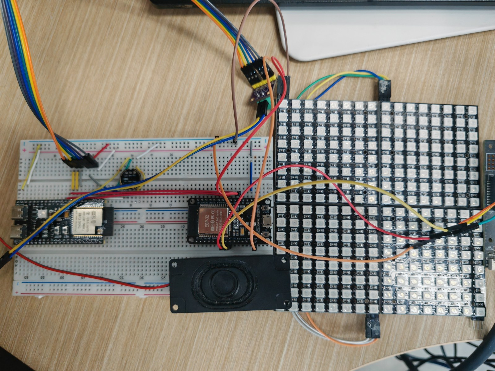
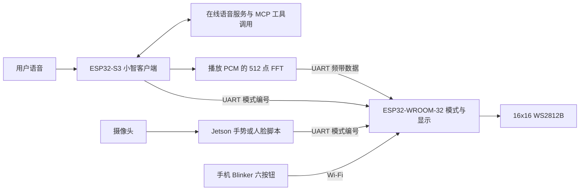
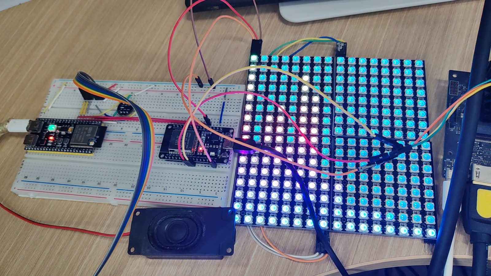
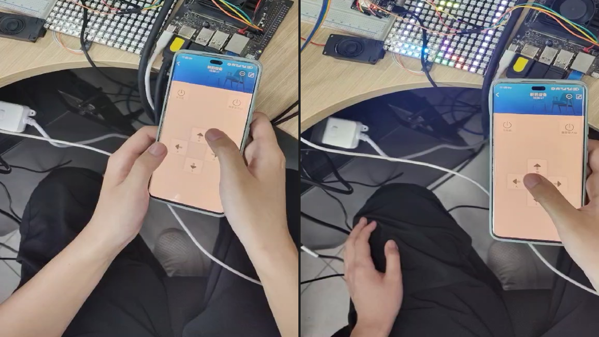

# Intelligent Lighting Control System — Mid

结合双 ESP32、Jetson Nano、在线语音与音频频谱的多模态灯光交互原型。

**简体中文** · [English](README.md) · [日本語](README_JA.md)

**深入阅读：** [模块与版本](docs/technical-notes.zh-CN.md#source-map) · [音频处理](docs/technical-notes.zh-CN.md#audio) · [显示与游戏](docs/technical-notes.zh-CN.md#display-games) · [视觉交互](docs/technical-notes.zh-CN.md#vision) · [部署操作](docs/setup.zh-CN.md)

Mid 是 **Basic → Mid → Pro** 三阶段项目的中阶课程原型，又名“智光魔方”。ESP32-S3 基于小智开源客户端连接在线语音服务，ESP32-WROOM-32 执行灯效和游戏，Jetson Nano 通过摄像头识别预设手势和已登记人脸，并经 UART 触发显示模式。

相较于 [Basic](https://github.com/DongFengPo1412/Intelligent-Lighting-Control-System-Basic) 的离线固定命令与随机音乐灯效，本阶段加入服务端语音工具调用、实际播放音频的 FFT 分析、视觉控制及俄罗斯方块。[Pro](https://github.com/DongFengPo1412/Intelligent-Lighting-Control-System-Pro) 是另一个独立工程，本页只描述 Mid。

以此前课程四块8×8板的照片为历史硬件证据；当前源码为单块16×16逐行蛇形映射。WROOM修订版已完整编译，S3未完整构建，均未重新烧录或做面板实测。

## 系统架构

S3 承担语音客户端与播放音频分析，WROOM 承担像素显示、串口分发及游戏更新。视觉脚本是分别启动的程序，没有统一的人脸／手势融合调度器。在线对话与点歌依赖外部服务；基本串口灯效和游戏逻辑可在 WROOM 上执行。

## 功能与具体实现

| 功能 | 实现方式 | 实现范围 |
| :--- | :--- | :--- |
| **语音控制** | 小智客户端处理音频和会话；`self.device.set_light_mode` 将服务端工具参数转换为串口编号。 | 集成现成语音框架，没有本地自研大模型训练。音乐检索／播放依赖服务端工具。 |
| **灯效与表情** | FastLED 的填色、HSV、正弦变化与衰减函数，配合自编像素几何绘制。 | 模式 1–14 包括纯色、彩虹、呼吸、流星、星点、雨滴、波纹及表情；并非全部都是动态灯效。 |
| **播放频谱** | 对播放队列 PCM 加 Hann 窗、512 点 FFT、16 频带聚合、归一化与对数幅度压缩。 | 分析扬声器播放的数据，不是环境声音；WROOM 用经验衰减和颜色叠加呈现。 |
| **两种点阵游戏** | 贪吃蛇支持穿墙、自碰撞、吃食加速；俄罗斯方块支持七类形状、旋转、碰撞与消行。 | 分别进入 19／21，结束进入 20／22，用 5×3 数字字模显示两位得分。 |
| **手机操作** | `BLINKER_WIFI` 路径绑定 W/S/A/D/E/F 六个按钮。 | 方向／旋转／下落与两种游戏入口；当前没有手机调色盘或通用灯效选择回调。 |
| **手势与人脸联动** | MediaPipe Hands 关键点规则分类；Haar 检测后用 OpenCV LBPH 比对登记人脸。 | 手掌／胜利／握拳映射 5／6／7，登记名 `ylk`／`zzc` 映射 1／2，即红／蓝。 |

[模式、算法、源码位置与限制](docs/technical-notes.zh-CN.md)

## 主要工程设计

- **按任务分配节点：** 将语音与播放分析、视觉处理、灯板执行分到三个计算节点，经文本串口协议连接，便于单独调试各输入路径。
- **共享坐标映射：** 普通绘图与频谱共同使用 `MatrixLayout::PixelIndex`，当前按单块 16×16 的奇偶行方向计算索引。
- **音频到显示：** S3 发送 `f,beat,b0,...,b15`；WROOM 立即解析并刷新频谱，普通模式则在主循环按超过 30 ms 的间隔提交显示。
- **状态冲突处理：** S3、Jetson 和 USB 的完整合法串口模式命令可立即切换，包括从音乐模式退出；没有旧的 1.2 s UART 保护门。Blinker 的 E/F 游戏入口仍在音乐模式 15 下被拦截，因此各输入路径并非统一仲裁。

公式、频带边界、游戏细节和协议问题保留在[技术说明](docs/technical-notes.zh-CN.md)，部署与逐功能检查见[操作指南](docs/setup.zh-CN.md)。

## 课程演示与当前状态

| 灯板显示片段 | 手机游戏操作片段 |
| :---: | :---: |
|  |  |

[观看课程演示视频](https://www.bilibili.com/video/BV192GR6kEHy)。图片与视频用于展示课程原型，不构成 FFT 延迟、视觉识别率或当前单块灯板改版的性能证明。视觉演示画面见[技术说明](docs/technical-notes.zh-CN.md#vision)。

本轮通过14组协议/游戏离线用例及WROOM完整构建。S3只完成源码检查，未做硬件、训练或端到端测试；历史演示不能替代修订版验收。

## 快速开始

1. 确认硬件对应当前单块蛇形映射还是历史拼接版，并检查实际供电及 UART 接线。
2. WROOM 使用 Arduino ESP32、FastLED 和 Blinker；保留 `Config.h`，单独创建忽略跟踪的 `Config.private.h` 填写凭证，**不要用旧 `Config.example.h` 覆盖主配置**。
3. S3 使用 ESP-IDF；当前依赖清单要求 **>=5.5.2**。选择实际板型、音频引脚和资源后构建，不能只靠 `set-target` 完成硬件配置。
4. Jetson 需兼容的 OpenCV contrib、MediaPipe、NumPy、pyserial、摄像头及显示环境；先验证串口，再分别启动手势或人脸脚本。

完整命令、配置片段、按键和复现前置检查见[部署与操作](docs/setup.zh-CN.md)。

## 团队、后续工作与许可

这是团队课程项目，仓库由 **刘超然 / Chaoran Liu** 维护。课程 PPT 列出刘超然、张子琛、杨立科，但粒度不足以确认各模块的个人作者；未据此认定全部软件由某个人独立完成。

后续重点是完成 S3 构建、确认实际 Flash 与分区、单块面板和 UART 线序，并验证手机／串口入口的不同切模策略。静音帧、协议校验和已覆盖的游戏边界已经修复；仍需实机记录，不将离线检查当作硬件验收。

[技术说明](docs/technical-notes.zh-CN.md) · [部署操作](docs/setup.zh-CN.md) · [Basic](https://github.com/DongFengPo1412/Intelligent-Lighting-Control-System-Basic) · [Pro](https://github.com/DongFengPo1412/Intelligent-Lighting-Control-System-Pro)

仓库采用 [MIT 许可证](LICENSE)。S3 工程保留小智客户端及其上游文档；ESP-DSP、ESP-SR、FastLED、Blinker、OpenCV、MediaPipe 等第三方组件保留各自许可。项目工作在于应用集成、控制协议、频谱显示、游戏与视觉事件联动，不把库算法本身归为自研。

## 维护修订与验证

2026-10 修复版：静音帧包含节拍与16频带，频谱严格校验字段数和范围，无效帧不刷新；超过500 ms没有有效帧后每30 ms继续衰减，零输入不再强制画底行。串口使用96字节固定缓存，超长帧丢弃至分隔符，模式只允许0–16、19–22，所有发送端必须以CR/LF结束。合法显式模式（包括0）可以立即退出音乐，不再由旧保护门丢弃。

S3 GPIO17 TX→WROOM GPIO16 RX并共地；反向UART不使用，WROOM TX配置为-1，S3不分配GPIO18给RX。GPIO18留给灯控制器，不应再连接旧的WROOM→S3反向线。接线仍需按实际开发板确认。

14组离线用例从实际协议头和游戏函数编译为WebAssembly并执行通过，覆盖模式、静音帧、畸形/越界/超长帧和游戏边界。S3固件未完整构建，未烧录、连接UART或重测历史演示；具体WROOM构建结果见维护报告。

WROOM完整构建通过：Arduino ESP32 3.3.8、FastLED 3.9.15、Blinker 0.3.10230510、ArduinoJson 7.4.3；应用1348101字节，静态RAM60588字节。测试使用4 MiB Flash配置及官方 `min_spiffs` 分区（应用上限1966080字节），不代表已核验实际板载Flash。默认应用分区不足；烧录前必须确认硬件容量与分区。当前FastLED 3.10.5在本机触发编译器内部错误，3.9.15在隔离目录验证成功，全局库未改动。
