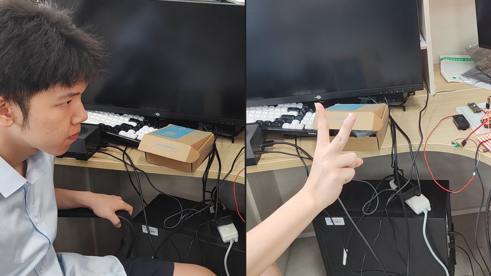

# Mid technical notes

[简体中文](technical-notes.zh-CN.md) · **English** · [日本語](technical-notes.ja.md) · [Project overview](../README_EN.md)

[Source and versions](#source-map) · [Voice tools](#speech) · [Audio algorithms](#audio) · [Display and games](#display-games) · [Vision](#vision) · [Communication](#communication) · [Implementation scope](#implementation-status)

These notes primarily follow current repository source. Course demonstrations, desktop copies, and slides establish historical context; features from different versions are not combined into an assumed validated system.

<a id="source-map"></a>

## Modules, files, and versions

| Module | Main files | Confirmed responsibility |
| :--- | :--- | :--- |
| S3 startup/transport | [main.cc](../esp32-s3r16n8-idf/main/main.cc), [application.cc](../esp32-s3r16n8-idf/main/application.cc) | UART1 initialization, XiaoZhi sessions/state machine, network audio, MCP dispatch. |
| Voice tool | [mcp_server.cc](../esp32-s3r16n8-idf/main/mcp_server.cc) | Registers `self.device.set_light_mode`, schedules mode numbers, toggles music analysis. |
| Audio processing | [audio_service.cc](../esp32-s3r16n8-idf/main/audio/audio_service.cc), [audio_service.h](../esp32-s3r16n8-idf/main/audio/audio_service.h) | Input/output/Opus tasks and queues; FFT and serial transmission from playback PCM. |
| WROOM entry | [Main sketch](../esp32-wroom-32-arduino/esp32-wroom-32-arduino.ino) | Wi-Fi/Blinker startup, three serial inputs, mode initialization, display updates. |
| Display | [MatrixLayout.h](../esp32-wroom-32-arduino/MatrixLayout.h), [DisplayManager.h](../esp32-wroom-32-arduino/DisplayManager.h) | Shared serpentine mapping, pixels, glyphs, faces, display presets 1–14. |
| Spectrum renderer | [SpectrumManager.h](../esp32-wroom-32-arduino/SpectrumManager.h) | Seventeen-integer parsing, column decay, bottom-up drawing, beat-color overlay. |
| Games/phone | [GameEngine.h](../esp32-wroom-32-arduino/GameEngine.h), [BlinkerManager.h](../esp32-wroom-32-arduino/BlinkerManager.h) | Snake, Tetris, two-digit scores, six button callbacks. |
| Vision | [run_gesture2.py](../jetson-nano-py36/run_gesture2.py), [face_system_cn.py](../jetson-nano-py36/face_system_cn.py) | Separate gesture and face-enrollment programs emitting UART mode numbers. |

The audit baseline is local commit `f9419ba`, following the earlier remote `4dcabf9`. It changes panel mapping and adds `MatrixLayout.h`; it was initially local-only and has now been published with this documentation following owner approval. It remains unbuilt, unflashed, and hardware-unvalidated. Course photographs and the desktop `LightSystem3` copy use four 8×8 panels. This documentation describes the new mapping while identifying historical demonstrations separately.

All five desktop `py36` scripts are byte-identical to the repository. WROOM files in older `LightSystem1/3` copies differ and are not used to overwrite this version. The S3 tree contains many upstream XiaoZhi boards/examples; their presence does not establish support on this prototype. Nested upstream READMEs do not define this project's complete deployment conditions.

<a id="speech"></a>

## Online speech, MCP, and state

`app_main → Application::Initialize/Run` starts the application. Input tasks feed microphone data to wake/audio processing and Opus encoding; network services return audio and MCP messages. Playback consumes decoded PCM. A complete offline-reproducible server for recognition, dialogue, synthesis, and music is not distributed here.

The actual tool is `self.device.set_light_mode`, with integer `mode` in 0–22. Both 15 and 16 become WROOM mode 15; `Schedule` sends the newline-terminated number, and the tool sets `is_music_mode_`. The music branch returns instructions requesting server-side `%search_music`/`%play_music`; it is not a local music downloader and does not guarantee arbitrary song availability. Other modes disable S3 music analysis.

WROOM mode 16 displays a yellow smile, but no automatic `16` transmission was found in the S3 wake path. Automatic matrix wake feedback is therefore not established. Arguments 17/18 are accepted by the tool but have no display implementation. Commented A2DP/`play_online_music` code is not a working Bluetooth speaker feature.

On `tts stop`, non-manual sessions return to Listening; closing the audio channel returns to Idle. This client state flow is not permanent offline continuous recognition. Speech SDK, Opus, and MCP foundations are upstream work; project extensions mainly connect mode tools and playback analysis.

<a id="audio"></a>

## FFT of playback audio and visualization

### Source and windows

FFT runs in `AudioOutputTask` after `codec_->OutputData(task->pcm)`, using the same PCM. `OpusCodecTask` decodes and, if needed, resamples to the codec output rate. The local, untracked `sdkconfig` selects `BREAD_COMPACT_WIFI`, whose configuration uses 16 kHz input and 24 kHz output. Other board choices require rechecking the output rate.

Analysis requires music mode and available PCM. N=512; ESP-DSP generates a Hann window and performs a complex radix-2 FFT with zero imaginary input, followed by bit reversal and magnitudes. For int16 PCM s[n]:

```math
u[n]=s[n]/32768,\quad w[n]=\tfrac12\left(1-\cos\frac{2\pi n}{N-1}\right),\quad
X[k]=\sum_{n=0}^{N-1}u[n]w[n]e^{-j2\pi kn/N}
```

RMS is computed on **unwindowed** u[n]; RMS<0.005 enters the silence branch. Accumulation beyond 1536 samples retains only the latest 1024, while normal processing consumes 512 at a time. Windows do not overlap, and not every sample is guaranteed analysis. At 24 kHz, the theoretical window duration is 21.33 ms and bin spacing is 46.875 Hz; neither is measured compute latency or a guaranteed packet rate.

### Bands, amplitude, and beat rule

Edges are `[1,2,3,4,5,7,9,12,16,22,30,41,56,76,103,140,200]`. Each half-open interval produces the **mean magnitude**. DC and bins 200–255 are omitted. This is not a standard Mel/Bark filter bank or compression of all 256 bins. At 24 kHz, used bin centers span approximately 46.875–9328.125 Hz.

For band mean a_i and shared peak tracker P, initialized to 0.01:

```math
P_t=\max(0.98P_{t-1},\max_i a_i,0.01),\qquad
v_i=\left\lfloor15\frac{\ln(1+10a_i/P_t)}{\ln11}\right\rfloor
```

Integer values at indices 13–15 are then halved and clamped to 0–15. The multiplier for indices >=10 is 1.0, not extra gain. Low-frequency quantity L is the **sum of magnitudes**, not squared energy, at bins 1–4: approximately 46.875–187.5 Hz at 24 kHz.

```math
\mathrm{beat}_t=[L_t>1.3E_{t-1}]\land[L_t>0.15]\land[\mathrm{RMS}>0.015],\qquad
E_t=0.6L_t+0.4E_{t-1}
```

This is a heuristic low-frequency transient flag, not an evaluated beat/BPM/drum classifier. The previous 1.45 ratio, RMS>0.08, and 0–120 Hz descriptions do not match the source.

### WROOM columns

A valid frame requires beat plus sixteen bands after `f,`: seventeen integers. If column 0 is <=1, it becomes column 1 plus 1; beat=1 forces column 0 to 15. The display therefore includes visual compensation and is not a calibrated acoustic measurement.

Rises immediately follow input. Falls apply a fixed-plus-proportional decrement **per packet render**:

```math
h_i'=\begin{cases}b_i,&b_i\ge h_i\\h_i-(0.4+0.05h_i),&b_i\lt h_i\end{cases}
```

In the falling branch, if h_i'<b_i+0.2 and b_i<=2, the result becomes b_i, not necessarily zero, then is bounded below by zero. There is no velocity state or time step: this is empirical decay smoothing rather than gravity/air-resistance simulation. Drawing uses `y=0..int(h_i)` and physical row `15-y`, so even zero draws a bottom pixel. Beats add `CRGB(0,25,25)`, a cyan component rather than white flashing.

<a id="display-games"></a>

## Coordinates, modes, and games

### Single-panel serpentine mapping

`MatrixLayout::PixelIndex` returns -1 outside the panel and is shared by ordinary drawing and spectra. The front-view origin is top-left, with even rows left-to-right and odd rows reversed:

```math
i(x,y)=16y+\begin{cases}x,&y\bmod2=0\\15-x,&y\bmod2=1\end{cases},\qquad 0\le x,y<16
```

Examples: (0,0)→0, (15,0)→15, (0,1)→31, (15,1)→16. This does not match the four-tile wiring in course photographs or validate that historical wiring. The implementation uses no lookup table, but no nanosecond benchmark exists.

### Actual modes

| ID | Action | Entry and scope |
| :--- | :--- | :--- |
| 0 | Clear/standby | Serial or voice tool; S3 reset suppression may temporarily reject it. |
| 1/2/3 | Red/blue/green | Serial/tool; faces send only 1/2. |
| 4/5/6/7 | Rainbow/breathing/meteor/stars | Gestures target 5/6/7; effects use FastLED helpers. |
| 8/9/10 | Color wash/random rain/radial ripple | 8 uses uniform HSV, 9 random pixels; only 10 computes radial distance. |
| 11/12/13/14 | Smile/sad/neutral/alternating face | Circular outline and fixed eye/mouth pixels; 14 alternates smile/sad with hue. |
| 15 | Spectrum | Refreshed by spectrum packets; sending 15 alone creates no audio. |
| 16 | Yellow smile | Defined on WROOM; tool argument 16 becomes 15 on S3. |
| 19/20 | Snake/score | E or tool 19; self-collision enters 20. |
| 21/22 | Tetris/score | F or tool 21; spawn collision enters 22. |
| 17/18 | Unsupported | Rejected by the mode whitelist. |

### Game mechanics and limits

Snake now selects food from bounded unoccupied cells, preserves the old tail when growing, and ends at full capacity. A direction request is applied once per tick and cannot reverse the last committed direction. The 450 ms initial/80 ms minimum intervals, two-digit display and Tetris rules remain; these fixes are not performance measurements.

Tetris stores a 16×16 array and uses x=3..12 as a ten-column playfield with side walls. Seven shapes have four stored rotations. Collision checks horizontal bounds, floor, and settled cells. Initial drop interval is 800 ms; each cleared row adds one point and subtracts 30 ms, down to 100 ms. A cleared row is rechecked after shifting. W rotates, S moves down one cell, and A/D move sideways. Wall kicks, hard drop, and rotation interpolation are absent.

`drawGameScore` renders two glyphs, effectively the last two score digits. Initialization runs only when `currentMode != lastMode` on entering 19/21; sending the same active mode again does not restart a game.

<a id="vision"></a>

## Jetson vision events



These are interaction scenes, without recognition-window or timing evidence; they do not establish accuracy, algorithm output, or 30 FPS throughput.

- [run_gesture.py](../jetson-nano-py36/run_gesture.py): MediaPipe Hands for one hand; compares thumb x and other fingertips/joints in y, emitting finger counts 0–5.
- `run_gesture2.py`: adds a 0.02 y threshold for four fingers; victory takes priority as 6, fist as 7, open hand as 5, and other poses still emit counts 1–4. Rules depend on orientation/mirroring; no rotation-invariant classifier or project-trained gesture network exists. Only changed results are sent, with deduplication reset on hand loss; no temporal voting.
- `face_system_cn.py`: Haar detection, grayscale 100×100 crops, OpenCV LBPH training/prediction; full local retraining at startup and T. S saves the first detected face under an entered directory name; Q exits. `conf<80` is a distance threshold, not 80% probability. `ylk→1` means red and `zzc→2` means blue; the local guide's “2 green” is outdated wording.
- [face_system.py](../jetson-nano-py36/face_system.py): headless by default, threshold 95, an additional 0.05 s loop sleep, and no enrollment keys. It is not an equivalent substitute for the preceding script.
- [face_pyserial.py](../jetson-nano-py36/face_pyserial.py): earlier enrollment version without later uniform crop sizing; the `pickle` import and `DATA_FILE` do not implement model persistence.

There is no `recognizer.update` or saved model, so this is not online incremental learning. Only `faces/ylk/.gitkeep` and `faces/zzc/.gitkeep` are tracked, without face images or trained weights. Main scripts share a camera and `/dev/ttyTHS1` and should run separately; no process resource arbitration is implemented. MediaPipe performs inference, with no code evidence of CUDA acceleration.

<a id="communication"></a>

## Communication and mode arbitration

S3 UART1/WROOM Serial1 and Jetson Serial2 use 115200 8N1. Modes are decimal plus CR/LF; spectra are `f,beat,b0,...,b15` plus CR/LF. Beat is 0/1 and bands are 0–15. State changes only after complete validation. There is no checksum, sequence, ACK or retransmission.

Ordinary display submissions retain the >30 ms gate. Spectrum rendering follows valid input and continues decaying after input stops. These are scheduling settings, not measured FPS or hard-real-time guarantees.

| Path | Actual behavior | Limitation |
| :--- | :--- | :--- |
| S3 | Bounded frames, field/range and mode validation; explicit mode commands can exit music. | No hardware ACK or delivery-rate evidence. |
| Jetson/USB | CR/LF is required; a 50 ms timeout no longer promotes partial input to a command. | Update older senders that omit newlines. |
| Blinker | W/S/A/D control active games; E/F enter games. | E/F always reject in mode 15; no color picker, full effects menu, or music-exit button. |

A fixed 96-byte frame buffer replaces `String.reserve`; oversized frames are discarded. Temporary `String(line)`, audio vectors and third-party libraries may still allocate; zero-allocation operation is not claimed.

With one-digit beat and bands 0–15, valid spectrum text occupies roughly 36–52 bytes. At 8N1/115200 its wire serialization is about 3.13–4.51 ms, excluding processing/queues; this is not measured end-to-end delay. FastLED's 5 V/1200 mA setting is an estimated software power budget, not measured current, a hardware current regulator, or supply rating.

<a id="implementation-status"></a>

## Validation scope, known issues, and further work

Fourteen offline cases compile the real protocol header/game functions to WebAssembly and pass: modes, silence, malformed/range/overflow frames and game boundaries. S3 was not fully built and no flashing, UART connection or fresh demonstration test occurred; the maintenance report records the WROOM build outcome separately.

| Area | Current implementation or limit | Validation boundary |
| :--- | :--- | :--- |
| Silence/bands | 17 values; beat 0/1, bands 0–15; malformed input rejected. | Offline protocol tests pass. |
| Music exit/stale input | Explicit valid modes exit music; decay continues after 500 ms without input. | No board-to-board test. |
| Pins | S3 TX17→WROOM RX16; reverse UART disabled. | Disconnect the old reverse wire; GPIO18 belongs to the lamp controller. |
| Panel revision | Current single-panel mapping differs from historical tiled photographs. | No physical panel validation. |
| S3 environment | IDF>=5.5.2; sdkconfig, lock and managed_components are untracked. | No full S3 build; clean-clone setup/assets remain required. |
| Games | Food exclusion, old-tail growth, full board and turning fixed; scoring remains two-digit. | Fourteen protocol/game cases are not hardware acceptance. |
| Vision | Scripts still share camera/serial; face samples/models are not distributed. | No unified arbitration or new recognition results. |

Previous precise latency, 100% delivery, 0% accidental switching, endurance testing, electrical isolation, a rated 3 A supply, and nanosecond mapping lack reproducible records and are not claimed. Next steps are protocol/configuration fixes followed by recorded toolchain, panel version, input cases, timing, and recognition trials. Library capabilities are not project benchmarks.

Course slides list Liu, Zhang, and Yang with broad roles; Bluetooth, enclosure, and module descriptions do not fully match the current implementation. This document covers team work, with individual module authorship still requiring confirmation. Third-party framework capabilities are not individual original research.

The 2026-10 revision sends beat plus sixteen bands in silence frames and validates spectrum field count/ranges before updating. After 500 ms without a valid frame, decay continues every 30 ms; zero input no longer forces a lit bottom row. Serial reception uses a fixed 96-byte buffer, drops oversized frames through the delimiter, permits modes 0–16 and 19–22, and requires CR/LF from every sender. Explicit valid mode commands, including 0, can exit music immediately instead of being discarded by the old guard.

Fourteen offline cases compile the real protocol header/game functions to WebAssembly and pass: modes, silence, malformed/range/overflow frames and game boundaries. S3 was not fully built and no flashing, UART connection or fresh demonstration test occurred; the maintenance report records the WROOM build outcome separately.

The WROOM build passes with Arduino ESP32 3.3.8, FastLED 3.9.15, Blinker 0.3.10230510 and ArduinoJson 7.4.3: application 1348101 bytes, static RAM 60588 bytes. It uses a 4 MiB Flash configuration and the official `min_spiffs` partition (1966080-byte application limit), without verifying physical Flash capacity. The default app partition is too small; confirm hardware and partitioning before upload. FastLED 3.10.5 triggered a compiler internal error here; 3.9.15 passed in isolation without changing global libraries.
